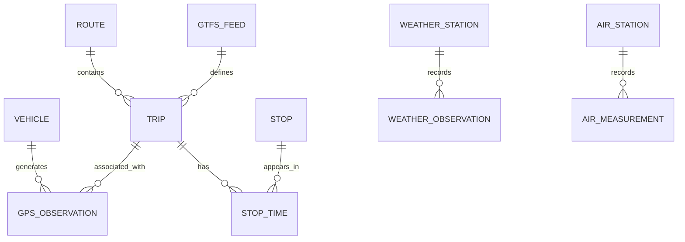

# Data Schemas and Interfaces — Big Data ZTM

**Version:** 1.1 (Docker-contained scheduling and cross-platform startup, 2026-11-15)  
**Scope:** Python source simulation, NiFi, Kafka, HDFS Raw, Spark batch, HDFS Cleaned and Hive external tables.  
**Status:** Acquisition/ingestion and the batch cleaned layer are **[IMPLEMENTED]**. Spatiotemporal enrichment, delay prediction and Kafka-based Spark streaming remain **[PLANNED]**. Examples are illustrative, not live API responses.

## 1. Data Exchange Architecture

```text
GPS API ────────────┐
                    │
Weather API ────────┼──> Python (source simulator) ──HTTP/JSON──> NiFi
                    │                                           ├──> HDFS Raw: complete JSON snapshots
Air Quality API ────┘                                           └──> Kafka: gps / weather / air_quality
GTFS ZIP ─────────────────────────────────────────> NiFi ───────> HDFS Raw: GTFS ZIP

HDFS Raw (JSON + ZIP) ──> Spark batch ──> HDFS Cleaned (Snappy Parquet)
                                           └──> Hive external tables cleaned.*
Optional Docker batch-scheduler (15 min) ──> Spark + Hive metadata
Kafka ──> planned streaming/speed layer (NOT read by the batch cleaner)
```

**Responsibility boundaries:** Python simulates data arrival (buffered GPS and interpolated or carried-forward environmental data). NiFi ingests, validates, short-term-deduplicates, archives JSON/ZIP in HDFS and publishes event messages to Kafka. Spark **batch** reads immutable archived HDFS Raw files and performs validation, long-lived business-key deduplication and versioned/partitioned Parquet conversion. Hive exposes external tables over these Parquet paths. No GPS→GTFS/weather/air-quality joins or predictions are implemented here; these belong to the downstream layer.

## 2. Python → NiFi Interfaces [IMPLEMENTED]

| Stream | Method / URL inside the Docker network | Request structure | Emission frequency |
|---|---|---|---|
| GPS | `POST http://nifi:8081/gps` | `{"time": ..., "positions": [...]}` | Every 10 seconds, after a 15-minute buffer from snapshot receipt |
| Weather | `POST http://nifi:8082/weather` | `{"stations": [...]}` | Every 30 seconds, for the target time 15 minutes earlier |
| Air quality | `POST http://nifi:8083/air-quality` | `{"stations": [...]}`, each station containing `data: [...]` | Every 30 seconds, for the target time 15 minutes earlier |

Python polls GPS every 10 seconds and weather and air quality every 60 seconds. Environmental measurements are interpolated when observations are available on both sides of the target time. Otherwise, the latest available earlier value is used. The simulator does not generate measurements for times preceding the first known observation. The simulator is optional. The `--with-data` / `-WithData` choice controls both the simulator and the NiFi GTFS download flow; disabling acquisition stops the GTFS daily trigger without deleting archives.

## 3. Apache Kafka Topics [IMPLEMENTED]

| Topic | Message unit (value) | Kafka key | NiFi deduplication key |
|---|---|---|---|
| `gps` | One vehicle position | `trip_id:side_number` | `trip_id:side_number:timestamp` (15-minute window) |
| `weather` | One station's measurements at one timestamp | `lokalizacja` | `weather:lokalizacja:czas` (1-hour window) |
| `air_quality` | One **pollutant parameter** at one station and timestamp | `name:param_code` | `air_quality:name:param_code:time` (1-hour window) |

**Serialization:** Each Kafka value is a **UTF-8 JSON object**, enriched with `ingested_at` by NiFi. Kafka keys are strings. `ingested_at` represents the processing time in NiFi, not the observation time. NiFi's cache-based deduplication has a limited retention window and does **not** guarantee end-to-end exactly-once delivery.

### 3.1 GPS Record Schema

| Field | Type | Required | Meaning |
|---|---|---|---|
| `id` | string | Yes | Source record identifier |
| `timestamp` | string (ISO 8601 with offset or `Z`) | Yes | Vehicle position timestamp |
| `lat`, `lon` | number | Yes | WGS84 geographic coordinates |
| `side_number` | numeric string | Yes | Vehicle fleet/side number |
| `trip_id` | string | Yes | Trip identifier used for GTFS matching |
| `service_date` | string, `YYYYMMDD` | Yes | Trip service date |
| `bearing` | number | No | Travel direction, when available |
| `ingested_at` | string | Added by NiFi | Event processing timestamp |

Example Kafka value:

```json
{
  "id": "gps-record-123",
  "timestamp": "2026-11-15T02:30:10Z",
  "lat": 52.2297,
  "lon": 21.0122,
  "side_number": "1234",
  "trip_id": "trip-example",
  "service_date": "20261115",
  "bearing": 90.0,
  "ingested_at": "2026-11-15T02:45:12.000Z"
}
```

### 3.2 Weather Record Schema

| Field | Type | Required | Meaning |
|---|---|---|---|
| `lokalizacja` | string | Yes | Weather station name/identifier |
| `lat`, `lon` | number | Yes | Station location |
| `czas` | string, `YYYY-MM-DD HH:mm:ss` | Yes | Simulated measurement timestamp |
| `temp_pow` | number or null | No | Air temperature |
| `temp_naw` | number or null | No | Road surface temperature |
| `wilg_pow` | number or null | No | Relative air humidity |
| `pred_wiatru` | number or null | No | Wind speed |
| `kier_wiatru` | number or null | No | Wind direction |
| `int_opadu` | number or null | No | Precipitation intensity |
| `ingested_at` | string | Added by NiFi | Event processing timestamp |

Example Kafka value:

```json
{
  "lokalizacja": "Station A",
  "lat": 52.24,
  "lon": 21.01,
  "czas": "2026-11-15 03:00:00",
  "temp_pow": 4.2,
  "temp_naw": 3.8,
  "wilg_pow": 85.0,
  "pred_wiatru": 2.1,
  "kier_wiatru": 350.0,
  "int_opadu": 0.0,
  "ingested_at": "2026-11-15T02:15:01.000Z"
}
```

### 3.3 Air Quality Record Schema

| Field | Type | Required | Meaning |
|---|---|---|---|
| `name` | string | Yes at NiFi input | Air quality station name |
| `lat`, `lon` | number | Yes at NiFi input | Station coordinates |
| `param_code` | string | Yes | Parameter code, e.g., `PM10` |
| `param_name` | string | No | Parameter name |
| `value` | number | Effectively yes after simulation | Concentration or measurement value |
| `time` | string, `YYYY-MM-DD HH:mm:ss` | Yes | Simulated measurement timestamp |
| `unit` | string | No | Parameter unit |
| `ingested_at` | string | Added by NiFi | Event processing timestamp |

**Note:** The payload sent to NiFi contains stations with nested `data` arrays. NiFi splits them into individual parameter records and attaches `name`, `lat`, `lon`, and `ingested_at`. The simulator selects only stations where `address.city == "Warszawa"`.

Example Kafka value:

```json
{
  "name": "Station B",
  "lat": 52.24,
  "lon": 21.08,
  "param_code": "PM10",
  "param_name": "PM10 particulate matter",
  "value": 12.4,
  "time": "2026-11-15 03:00:00",
  "unit": "µg/m3",
  "ingested_at": "2026-11-15T02:15:01.000Z"
}
```

## 4. Raw Data in HDFS [IMPLEMENTED]

HDFS archives the **complete incoming payload**, before NiFi splits it into individual Kafka messages. This preserves the original request structure and makes it possible to replay or reprocess a snapshot later. NiFi does **not** add `ingested_at` to archived raw JSON.

> **Meaning of raw:** These are the payloads received by NiFi, not necessarily the unmodified responses from the original APIs. GPS snapshots are forwarded unchanged after buffering. Weather and air-quality snapshots are constructed by the Python simulator from interpolated or last-known measurements.

### 4.1 Directories, file formats, and partitioning

| Dataset | HDFS directory | Filename pattern | Content |
|---|---|---|---|
| GPS | `/data/raw/gps/date=YYYY-MM-DD/hour=HH/` | `snapshot_YYYYMMDD_HHMMSS_<uuid>.json` | One complete GPS snapshot, including `time` and `positions[]` |
| Weather | `/data/raw/weather/date=YYYY-MM-DD/hour=HH/` | `weather_YYYYMMDD_HHMMSS_<uuid>.json` | One complete simulated weather snapshot with `stations[]` |
| Air quality | `/data/raw/air_quality/date=YYYY-MM-DD/hour=HH/` | `air_quality_YYYYMMDD_HHMMSS_<uuid>.json` | One complete simulated air-quality snapshot with nested stations and `data[]` |
| GTFS | `/data/raw/gtfs/date=YYYY-MM-DD/` | `warsaw_YYYYMMDD_HHMMSS_<uuid>.zip` | Original downloaded static schedule archive |

The `date` and `hour` partitions for GPS, weather, and air quality use **NiFi archival time in UTC**, not source measurement time. GTFS uses the **Europe/Warsaw** calendar date. When acquisition is enabled, NiFi downloads the archive daily at 03:00 local time; if there is no nonempty GTFS ZIP in HDFS when acquisition is first enabled, the trigger is executed once immediately and the bootstrap waits for the archived ZIP (up to 300 seconds). The UUID in the filename prevents collisions. Files are stored as individual JSON snapshots; they are **not** Parquet files or flattened JSON Lines records.

### 4.2 Raw GPS snapshot

**Structure:** top-level `time` plus a `positions` array. Every item in `positions` represents one vehicle position. The original GPS snapshot is delayed by 15 minutes after receipt, but its contents are preserved.

Example HDFS file (illustrative):

```json
{
  "time": "2026-11-15T03:00:00+01:00",
  "positions": [
    {
      "id": "gps-record-123",
      "timestamp": "2026-11-15T03:00:00+01:00",
      "lat": 52.2297,
      "lon": 21.0122,
      "side_number": "1234",
      "trip_id": "trip-101",
      "service_date": "20261115",
      "bearing": 90.0
    },
    {
      "id": "gps-record-124",
      "timestamp": "2026-11-15T03:00:00+01:00",
      "lat": 52.2380,
      "lon": 21.0200,
      "side_number": "5678",
      "trip_id": "trip-202",
      "service_date": "20261115",
      "bearing": 180.0
    }
  ]
}
```

**Compared with Kafka:** NiFi splits `positions[]` into one message per vehicle and adds `ingested_at` to each message. The snapshot's top-level `time` remains in the HDFS JSON; the corresponding Kafka record uses its individual `timestamp` instead.

### 4.3 Raw weather snapshot

**Structure:** top-level `stations` array containing one flat weather object per station. The simulator emits a complete snapshot every 30 seconds for the target time 15 minutes earlier.

Example HDFS file (illustrative):

```json
{
  "stations": [
    {
      "lokalizacja": "Station A",
      "lat": 52.24,
      "lon": 21.01,
      "czas": "2026-11-15 03:00:00",
      "temp_pow": 4.2,
      "temp_naw": 3.8,
      "wilg_pow": 85.0,
      "pred_wiatru": 2.1,
      "kier_wiatru": 350.0,
      "int_opadu": 0.0
    },
    {
      "lokalizacja": "Station B",
      "lat": 52.28,
      "lon": 20.96,
      "czas": "2026-11-15 03:00:00",
      "temp_pow": 3.6,
      "temp_naw": null,
      "wilg_pow": 88.0,
      "pred_wiatru": 1.4,
      "kier_wiatru": 15.0,
      "int_opadu": 0.2
    }
  ]
}
```

**Compared with Kafka:** NiFi splits `stations[]` into one message per station and adds `ingested_at`. A weather Kafka message retains the flat station fields but does not contain the surrounding `stations` array. Individual meteorological fields can be `null` when no valid historical value was available.

### 4.4 Raw air-quality snapshot

**Structure:** top-level `stations` array. Each station contains station metadata (`name`, `lat`, `lon`, potentially `address` and other source metadata) and a nested `data` array. Each `data[]` item represents **one pollutant at one timestamp**, with its own `param_code`, `value`, `time`, and `unit`. Different parameters may have different timestamps in source observations; in the emitted simulated snapshot, each available measurement is evaluated for the selected target time.

Example HDFS file (illustrative):

```json
{
  "stations": [
    {
      "name": "Station A",
      "lat": 52.2297,
      "lon": 21.0122,
      "address": { "city": "Warszawa" },
      "data": [
        {
          "param_code": "PM10",
          "param_name": "PM10 particulate matter",
          "value": 24.5,
          "time": "2026-11-15 03:00:00",
          "unit": "µg/m3"
        },
        {
          "param_code": "NO2",
          "param_name": "Nitrogen dioxide",
          "value": 18.3,
          "time": "2026-11-15 03:00:00",
          "unit": "µg/m3"
        }
      ]
    },
    {
      "name": "Station B",
      "lat": 52.25,
      "lon": 21.05,
      "data": [
        {
          "param_code": "PM10",
          "param_name": "PM10 particulate matter",
          "value": 19.2,
          "time": "2026-11-15 03:00:00",
          "unit": "µg/m3"
        }
      ]
    }
  ]
}
```

**Compared with Kafka:** NiFi first splits the `stations[]` array, then splits every station's `data[]`. The example produces **three Kafka messages**, not two: `Station A / PM10`, `Station A / NO2`, and `Station B / PM10`. Each message contains the individual pollutant fields plus `name`, `lat`, `lon`, and `ingested_at` copied/added by NiFi. Station-level metadata such as `address` is retained in the HDFS snapshot but is **not automatically copied into Kafka records**. The simulator filters source stations to `address.city == "Warszawa"` and does not carry forward the source's categorical `ijp` index.

### 4.5 HDFS versus Kafka — contract summary

| Property | HDFS raw | Kafka |
|---|---|---|
| GPS message unit | Full snapshot with `positions[]` | One vehicle position |
| Weather message unit | Full snapshot with `stations[]` | One station measurement |
| Air-quality message unit | Full snapshot with `stations[].data[]` | One station-pollutant measurement |
| Original snapshot wrapper | Retained | Removed by splitting |
| `ingested_at` | Not added | Added by NiFi |
| Deduplication | Raw snapshots archived independently of Kafka deduplication | Duplicate filtering performed by NiFi before publishing |
| Storage | Individual JSON files; GTFS as ZIP | JSON values in the `gps`, `weather`, `air_quality` topics |

A snapshot may contain an **empty array** (`"positions": []` or `"stations": []`). Such a payload can still be archived in HDFS even when it yields no individual Kafka records.

## 5. Static GTFS [IMPLEMENTED]

Source: `https://mkuran.pl/gtfs/warsaw.zip`. NiFi archives the ZIP file; it is not published to Kafka. The Spark job extracts and types the following GTFS tables. `routes`, `stops`, `trips`, and `stop_times` are required; `calendar` and `calendar_dates` are optional:

| GTFS file | Key fields | Purpose |
|---|---|---|
| `routes.txt` | `route_id`, `route_short_name` | Transit route/line |
| `trips.txt` | `trip_id`, `route_id`, `service_id` | Trip assigned to a route |
| `stops.txt` | `stop_id`, `stop_name`, `stop_lat`, `stop_lon` | Transit stop |
| `stop_times.txt` | `trip_id`, `stop_id`, `stop_sequence`, `arrival_time`, `departure_time` | Scheduled stop arrivals and departures |
| `calendar.txt` / `calendar_dates.txt` | `service_id`, validity dates | Service calendar |

GPS trips must be matched against the appropriate **GTFS feed version** and `service_date`. GTFS times may exceed `24:00:00`; parsing them must account for the service day.

## 6. Cleaned Data Model [IMPLEMENTED]

The **cleaned layer** is a typed, source-oriented representation produced by Spark (not NiFi). Nine external Hive tables expose these outputs under database `cleaned`. It does **not** join vehicle positions with scheduled stops or environmental readings; those operations belong to a future enriched layer.

### 6.1 Format, locations, and partitions

**Storage format:** Apache Parquet with Snappy compression. Timestamp columns use Spark `TimestampType`, interpreted and written in **UTC**. Static GTFS identifiers remain strings to preserve leading zeros and source formatting. Dynamic datasets use the **UTC observation date** as the partition key (`date`), not the ingestion or archival date.

| Dataset | HDFS directory (implemented) | Partitioning | Deduplication key |
|---|---|---|---|
| `gps_observations` | `/data/cleaned/gps_observations/date=YYYY-MM-DD/` | UTC observation date | `(trip_id, side_number, event_time_utc)` |
| `weather_observations` | `/data/cleaned/weather_observations/date=YYYY-MM-DD/` | UTC observation date | `(station_id, event_time_utc)` |
| `air_quality_observations` | `/data/cleaned/air_quality_observations/date=YYYY-MM-DD/` | UTC observation date | `(station_id, param_code, event_time_utc)` |
| `gtfs_routes` | `/data/cleaned/gtfs_routes/feed_version=<id>/` | GTFS feed version | `(feed_version, route_id)` |
| `gtfs_stops` | `/data/cleaned/gtfs_stops/feed_version=<id>/` | GTFS feed version | `(feed_version, stop_id)` |
| `gtfs_trips` | `/data/cleaned/gtfs_trips/feed_version=<id>/` | GTFS feed version | `(feed_version, trip_id)` |
| `gtfs_stop_times` | `/data/cleaned/gtfs_stop_times/feed_version=<id>/` | GTFS feed version | `(feed_version, trip_id, stop_sequence)` |
| `gtfs_calendar` | `/data/cleaned/gtfs_calendar/feed_version=<id>/` | GTFS feed version | `(feed_version, service_id)` |
| `gtfs_calendar_dates` | `/data/cleaned/gtfs_calendar_dates/feed_version=<id>/` | GTFS feed version | `(feed_version, service_id, date)` (may contain more than one exception) |

For instance, a GPS output partition would be `/data/cleaned/gps_observations/date=2026-11-15/part-*.snappy.parquet`. The path partition columns (`date` or `feed_version`) are available when Spark reads the dataset as a partitioned directory; they need not be repeated in the underlying Parquet row files.

`feed_version` must uniquely identify the exact downloaded GTFS archive (for example, the download date combined with a short checksum), rather than only the nominal service date. `gtfs_calendar` and `gtfs_calendar_dates` are conditional on the respective files being present in the feed.

### 6.2 Implemented Parquet schemas

Types below use Spark SQL conventions: `STRING`, `DOUBLE`, `INT`, `DATE`, and `TIMESTAMP`; the Spark session timezone is UTC. An asterisk (`*`) indicates a nullable value. `date` and `feed_version` are path partition columns registered in Hive, not repeated inside the Parquet row file. The code enforces the stated business keys by deterministic deduplication in the dynamic layer.

**`gps_observations`** — one valid vehicle position:

| Column | Type | Source / meaning |
|---|---|---|
| `record_id` | STRING | Source `id` |
| `trip_id` | STRING | GPS `trip_id`; matching to GTFS is subject to verification |
| `side_number` | STRING | Vehicle fleet number |
| `service_date` | DATE | Parsed GPS `service_date` (`YYYYMMDD`) |
| `event_time_utc` | TIMESTAMP | Parsed GPS `timestamp`; offset-aware ISO source is expected |
| `source_file` | STRING | Full HDFS URI of archived input JSON |
| `ingested_at_utc` | TIMESTAMP* | **NULL**: HDFS Raw contains no NiFi `ingested_at` |
| `lat`, `lon` | DOUBLE | WGS84 position |
| `bearing` | DOUBLE* | Vehicle heading, if available |
| `date` | DATE | UTC event-date partition |

**`weather_observations`** — one observation from one weather station:

| Column | Type | Source / meaning |
|---|---|---|
| `station_id` | STRING | SHA-256(lowercase(trim(`lokalizacja`))); provisional and name-dependent |
| `station_name` | STRING | Original `lokalizacja` for traceability |
| `event_time_utc` | TIMESTAMP | Parsed `czas` |
| `ingested_at_utc` | TIMESTAMP* | **NULL** in cleaned Raw-derived data: NiFi does not persist `ingested_at` in raw JSON |
| `source_file` | STRING | Full HDFS URI of archived input JSON |
| `lat`, `lon` | DOUBLE | Station coordinates |
| `temp_pow`, `temp_naw` | DOUBLE* | Air and road-surface temperatures |
| `wilg_pow` | DOUBLE* | Relative humidity |
| `pred_wiatru`, `kier_wiatru` | DOUBLE* | Wind speed and direction |
| `int_opadu` | DOUBLE* | Precipitation intensity |
| `date` | DATE | UTC event-date partition |

**`air_quality_observations`** — one pollutant measurement at one station and time:

| Column | Type | Source / meaning |
|---|---|---|
| `station_id` | STRING | SHA-256(lowercase(trim(`name`))); provisional and name-dependent |
| `station_name` | STRING | Original station `name` |
| `param_code` | STRING | Pollutant parameter identifier, e.g. `PM10` |
| `param_name` | STRING* | Pollutant label |
| `event_time_utc` | TIMESTAMP | Parsed `time` |
| `ingested_at_utc` | TIMESTAMP* | **NULL** in cleaned Raw-derived data: NiFi does not persist `ingested_at` in raw JSON |
| `source_file` | STRING | Full HDFS URI of archived input JSON |
| `lat`, `lon` | DOUBLE | Station coordinates |
| `value` | DOUBLE | Pollutant measurement |
| `unit` | STRING* | Measurement unit as received |
| `date` | DATE | UTC event-date partition |

Meteorological field names preserve the source naming and units. The **implemented** weather/air-quality transformation treats timezone-less `czas`/`time` as `Europe/Warsaw` and converts it to UTC. Ambiguous or nonexistent local times during DST transitions are **not** separately validated by the current code and need a source-side policy. Station-name-based hashes are provisional (renames/collisions require a stable station catalog).

**GTFS reference tables** — typed rows extracted from the versioned ZIP:

| Dataset | Columns and Spark SQL types |
|---|---|
| `gtfs_routes` | `feed_version STRING`, `route_id STRING`, `route_short_name STRING*`, `route_long_name STRING*`, `route_type INT*` |
| `gtfs_stops` | `feed_version STRING`, `stop_id STRING`, `stop_name STRING*`, `stop_lat DOUBLE*`, `stop_lon DOUBLE*` |
| `gtfs_trips` | `feed_version STRING`, `trip_id STRING`, `route_id STRING`, `service_id STRING`, `trip_headsign STRING*`, `direction_id INT*` |
| `gtfs_stop_times` | `feed_version STRING`, `trip_id STRING`, `stop_sequence INT`, `stop_id STRING`, `arrival_time STRING*`, `departure_time STRING*`, `arrival_seconds INT*`, `departure_seconds INT*` |
| `gtfs_calendar` | `feed_version STRING`, `service_id STRING`, `monday BOOLEAN`, `tuesday BOOLEAN`, `wednesday BOOLEAN`, `thursday BOOLEAN`, `friday BOOLEAN`, `saturday BOOLEAN`, `sunday BOOLEAN`, `start_date DATE`, `end_date DATE` |
| `gtfs_calendar_dates` | `feed_version STRING`, `service_id STRING`, `date DATE`, `exception_type INT` |

GTFS `arrival_seconds` and `departure_seconds` count seconds from the **service-day start**; values can exceed 86,400 for scheduled times after `24:00:00`. Keep the original time strings as well. These are not UTC timestamps and must not be converted to an absolute instant without the service date and applicable timezone. Optional GTFS attributes can be added without changing the key contracts.

### 6.3 Cleaning and consistency rules

- Parse GPS ISO offset timestamps and treat naive weather/air-quality timestamps as Europe/Warsaw; retain `event_time_utc`, with unavailable `ingested_at_utc` left NULL in Raw-derived records.
- Filter records with missing identifiers, invalid coordinates (`-90..90` latitude, `-180..180` longitude), or unparseable timestamps; GPS invalid bearings become NULL and invalid air-quality values (NaN, negative) are filtered. **No quarantine or rejection metrics are implemented** in this batch.
- Deduplicate with the dataset-specific logical keys above during processing/reprocessing. The NiFi duplicate cache alone is not sufficient for permanent uniqueness; Spark applies window `row_number()` with `source_file` descending and full-row SHA-256 tie breaking.
- Preserve original station names and measurement units; never silently fill missing meteorological values or convert units without a verified rule.
- Use the exact GTFS `feed_version` for reproducible route/trip/stop references; GPS-to-GTFS trip correspondence still needs source-level validation.
- Write cleaned rows only to `/data/cleaned/...`; keep `/data/raw/...` immutable for replay and auditing.

## 7. Conceptual Data Model [PLANNED downstream]



**Entities and relationships:**

- A **vehicle (`VEHICLE`)** is provisionally identified by its fleet/side number and generates multiple GPS observations.
- A **route (`ROUTE`)** contains many **trips (`TRIP`)**. A trip represents a scheduled service associated with a service calendar and a date.
- A **trip (`TRIP`)** has an ordered sequence of **stop times (`STOP_TIME` → `STOP`)**, which forms the basis for calculating scheduled arrival times.
- A **GPS observation (`GPS_OBSERVATION`)** records a particular vehicle's position at a particular time and is associated with a trip.
- **Weather stations and their observations**, and **air quality stations and their measurements**, describe environmental conditions at a place and time. They have no direct foreign key to a vehicle.
- A **GTFS feed version (`GTFS_FEED`)** specifies the schedule against which planned arrival times are calculated.

**Joining datasets:** The GPS → trip → route/scheduled stops relationship is based on GTFS identifiers, once their consistency across sources has been verified. Matching GPS with weather and air quality requires a **spatiotemporal join**, for example selecting the nearest station and most recent available measurement within an allowed time window. Station selection, temporal tolerance, and quality rules must be agreed upon; they are not part of the current NiFi pipeline.


## 8. Batch processing and orchestration [IMPLEMENTED]

### 8.1 Raw → Cleaned incrementality

- Entry point: `scripts/clean-batch.sh [all|gps|weather|air_quality]`, invoking `spark/batch/run_pipeline.py` in the **on-demand** Docker Compose `batch-runner` container (`local[2]`, driver memory 2 GiB). That runner calls `clean_raw.run_dataset(...)` without changing its row-level contract.
- HDFS state root: `/data/cleaned/_pipeline_state`. A JSON manifest is stored at `raw/<dataset>.json`, with version `1` and the archived file's HDFS URI, size and modification timestamp; input files must remain immutable and append-only. Missing/altered previously processed JSON files cause a hard error.
- Only previously unseen raw JSON archives are loaded. Spark validates, flattens and deduplicates the new rows, merges them with any previously cleaned data in **affected UTC observation-date partitions**, and deduplicates again using the dataset-specific business key.
- Each rebuilt partition is first written to a unique `_pipeline_state/staging/...` location, then installed by HDFS directory rename while the prior version is temporarily held under `_pipeline_state/backups/...`. Backups are checked/recovered before a new run. The manifest is committed after all affected partitions are installed; interrupted runs may reprocess inputs, but business-key deduplication makes this retryable.
- The GPS/Spark stall observed in development was mitigated using `spark.locality.wait=0s` by default, controllable through `SPARK_LOCALITY_WAIT`; this is an operational workaround, not a guarantee for every deployment. The optional `SPARK_SCHEDULER_DEBUG=1` enables scheduler debug logs.
- `ingested_at_utc` is explicitly NULL for these three datasets, because the upstream NiFi `ingested_at` value is only on Kafka records, **not** archived JSON.

### 8.2 Versioned GTFS conversion

- Entry point: `scripts/clean-gtfs.sh [--force] [HDFS_ZIP_URI]`; the containerized scheduler visits all archived ZIPs, not only the latest.
- The Spark job (`spark/batch/clean_gtfs.py`) copies each ZIP from HDFS into temporary local container storage, parses individual UTF-8 CSV files and writes typed Parquet under `/data/cleaned/gtfs_<table>/feed_version=<version>`.
- The version is the archive directory's date plus the first 12 hexadecimal characters of the **ZIP content SHA-256** (`<date>-<sha12>`). The job preserves GTFS times over 24:00 as seconds since service-day start, without converting them to UTC.
- Completion markers in `_pipeline_state/gtfs/<hash>.done` are keyed to archive URI and HDFS size/mtime from the Hadoop API. Marker names can differ from the previous host-script implementation, causing a one-time safe reprocessing of previously handled archives after migration. A marker is created **only after** both the Spark job and Hive partition refresh succeed. Reruns can skip finished inputs; `--force` repeats conversion. Optional GTFS calendar files are written only when present.
- GTFS writes are per-table, **not one multi-table transaction**. Reprocessing an archive after an interruption can overwrite individual versions; markers keep the normal successful path idempotent.

### 8.3 Hive, startup and schedule

- `hive/sql/cleaned_tables.sql` creates nine external Parquet tables under database `cleaned`; `hive/sql/refresh_partitions.sql` runs `MSCK REPAIR TABLE ... SYNC PARTITIONS` for all nine. The combined Docker batch runner refreshes Hive metadata after Raw processing and after successful GTFS conversions; a GTFS completion marker is written only after the corresponding refresh.
- `scripts/bootstrap.sh` and `scripts/bootstrap.ps1` always start NiFi, Kafka, HDFS, PostgreSQL, Hive Metastore, HiveServer2, initialize the external tables, and run one incremental Spark batch immediately. `--with-data` / `-WithData` optionally enables the source simulator **and** NiFi GTFS acquisition (including a one-off initial download when HDFS is empty); `--with-schedule` / `-WithSchedule` optionally enables the Docker batch scheduler. Both are off by default. These features can be toggled later without restarting core infrastructure.
- `scripts/run-scheduled.sh` invokes the containerized batch runner. The runner and optional `batch-scheduler` share a Docker-volume file lock via Python `fcntl`, so overlapping manual and periodic runs are skipped. The Python clock runs **inside Docker** at 15-minute boundaries; no host cron, flock, Python or Docker socket is required. Logs are available via `docker compose --profile analytics --profile scheduler logs batch-scheduler`. Scheduling requires the Docker Engine to remain running.
- Spark in this repository is a **batch process**, not a permanently running Spark cluster or Kafka streaming consumer. Planned enrichment/forecasting remains separate.

## 9. Known limitations and verification

- NiFi cache deduplication is time-bounded; the batch manifest assumes immutability and requires a controlled rebuild after Raw deletion or mutation. The per-partition HDFS rename protocol is recoverable but not a cross-partition transactional commit.
- Station IDs depend on mutable names; timezone-less local timestamps can be ambiguous at daylight-saving transitions. Unit validation, full GTFS referential-integrity checks, rejected-row quarantine, quality dashboards and a streaming analytics layer are not yet implemented.
- The source `trip_id` to versioned GTFS `trip_id` correspondence and resulting lateness/delay calculations are not established here.
- Static validation: `bash scripts/validate-project.sh` or `.\scripts\validate-project.ps1` (Python tests run in Docker). On a running stack: `bash scripts/refresh-hive.sh` and a Beeline `SHOW PARTITIONS`/`SELECT COUNT(*)` against `cleaned.gps_observations`. All illustrative JSON examples above remain examples rather than API payload assertions.
