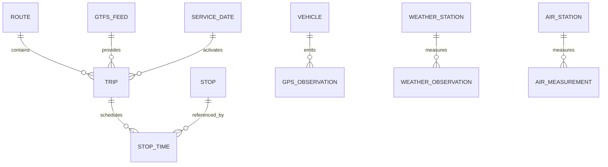

# Data Schemas and Interfaces — Big Data ZTM

**Version:** 2.0 (Spark/HDFS data contracts)  
**Scope:** source simulator, NiFi ingestion, Kafka topics, HDFS Raw, Spark batch stages,
HDFS Cleaned and HDFS Enriched.  
**Status:** ingestion, Raw -> Cleaned and GTFS trip/service Enriched are
implemented. GPS delay and environmental enrichment, Structured Streaming
and Cassandra are planned.
The normal batch always visits both stages, even when no new raw files exist.

## 1. Data Exchange Architecture

```text
GPS / Weather / Air Quality APIs
          | 
    Python simulator (optional)
          |
       NiFi  -------------> Kafka gps / weather / air_quality
          |
       HDFS Raw JSON

GTFS source ZIP -> NiFi -> HDFS Raw GTFS ZIP
                          |
                Spark Stage 1: Raw -> Cleaned
              - dynamic JSON cleaning/deduplication
              - GTFS ZIP to typed versioned Parquet
                          |
                HDFS /data/cleaned/*
                          |
                Spark Stage 2: Cleaned -> Enriched
              - implemented: GTFS trip/service date + route
              - future: GPS/GTFS and environment joins, delays
                          |
                HDFS /data/enriched/*

Future online path: Kafka -> Spark Structured Streaming
                    (+ static GTFS from HDFS) -> Cassandra
```

**No SQL catalog:** the Spark jobs read/write Parquet directly via HDFS paths.
The optional Docker scheduler repeats the entire batch cycle every 15 minutes.
Bootstrap runs one complete cycle whether the scheduler is enabled or not.

## 2. Upstream Data Sources [IMPLEMENTED]

The table below lists the external data sources configured for the pipeline. GPS, weather and air-quality data are obtained by `acquisition/simulator.py`; GTFS is downloaded separately by the NiFi `GTFS Ingestion` process group (see `nifi/flows/warsaw-ingestion.json`). The frequencies describe **this pipeline's polling/trigger configuration**, not guaranteed update frequencies of the data providers.

| Dataset | Upstream source (configured URL) | Response and access | Acquisition in this project |
|---|---|---|---|
| Vehicle GPS | [MKuranowski-hosted Warsaw vehicle positions](https://mkuran.pl/gtfs/warsaw/positions.json) | HTTP `GET`, JSON snapshot with `time` and `positions[]`; no API token is configured for this request | Python polls every **10 s**, buffers each received snapshot for **15 min**, then forwards the original snapshot to NiFi |
| Weather | [Warsaw City Open Data — `get_zom_pogoda`](https://dane.um.warszawa.pl/api/action/get_zom_pogoda) | HTTP `POST`, JSON array of station readings; request header `Authorization: <WEATHER_API_TOKEN>` | Python polls every **60 s** and emits simulated station snapshots every **30 s** for the target time 15 min earlier |
| Air quality | [Warsaw City Open Data — `get_bopipk_monitoring_jakosci_powietrza`](https://dane.um.warszawa.pl/api/action/get_bopipk_monitoring_jakosci_powietrza) | HTTP `POST`, JSON array of stations with nested `data[]`; same authorization header as weather | Python polls every **60 s**, retains stations whose `address.city` equals `Warszawa` after trimming/case folding, and emits simulated snapshots every **30 s** for the target time 15 min earlier |
| Static GTFS schedules | [Warsaw GTFS ZIP hosted by Mikołaj Kuranowski](https://mkuran.pl/gtfs/warsaw.zip) | HTTP download of a ZIP containing GTFS `.txt` (CSV) files; no API token is configured | NiFi downloads once on first `--with-data` startup **if no nonempty archived ZIP exists**, then uses a daily **03:00 Europe/Warsaw** trigger |

**Source provenance and scope.** The GPS and GTFS URLs are hosted by [Mikołaj Kuranowski's GTFS service](https://mkuran.pl/gtfs/); the weather and air-quality URLs are Warsaw municipal API endpoints. The simulator is an **upstream source emulator**, not the ingestion or storage layer: it delays GPS payloads and interpolates (or carries forward) environmental readings. Thus HDFS Raw stores **NiFi-received snapshots**, not necessarily verbatim responses from the original weather and air-quality APIs. NiFi then handles ingestion, extraction, short-window duplicate detection, archival and Kafka delivery.

**Authentication and rights.** `WEATHER_API_TOKEN` in `.env` is required for both environmental endpoints when `--with-data` is enabled; it must not be committed to the repository. The [GTFS feed publisher's page](https://mkuran.pl/gtfs/) refers to [ZTM Warszawa schedule-data terms](https://www.ztm.waw.pl/pliki-do-pobrania/dane-rozkladowe/), Open Database License obligations for applicable map-derived content, and attribution to the relevant parties (including ZTM Warszawa, Mikołaj Kuranowski and OpenStreetMap contributors). Check the current source terms and the archive's `attributions.txt` before publishing or redistributing data. This document does not grant reuse rights for any source.

The GTFS processing contract covers the source files listed in Section 6.
Service dates used by the enrichment stage come from `calendar_dates.txt`.

## 3. Python → NiFi Interfaces [IMPLEMENTED]

| Stream | Method / URL inside the Docker network | Request structure | Emission frequency |
|---|---|---|---|
| GPS | `POST http://nifi:8081/gps` | `{"time": ..., "positions": [...]}` | Every 10 seconds, after a 15-minute buffer from snapshot receipt |
| Weather | `POST http://nifi:8082/weather` | `{"stations": [...]}` | Every 30 seconds, for the target time 15 minutes earlier |
| Air quality | `POST http://nifi:8083/air-quality` | `{"stations": [...]}`, each station containing `data: [...]` | Every 30 seconds, for the target time 15 minutes earlier |

Python polls GPS every 10 seconds and weather and air quality every 60 seconds. Environmental measurements are interpolated when observations are available on both sides of the target time. Otherwise, the latest available earlier value is used. The simulator does not generate measurements for times preceding the first known observation. The simulator is optional. The `--with-data` / `-WithData` choice controls **source acquisition** (simulator and NiFi GTFS downloads), not the Spark cleaning contract. Disabling acquisition stops new simulator input and the GTFS daily trigger without deleting archived files; an explicitly started batch can still process already archived data.

## 4. Apache Kafka Topics [IMPLEMENTED]

| Topic | Message unit (value) | Kafka key | NiFi deduplication key |
|---|---|---|---|
| `gps` | One vehicle position | `trip_id:side_number` | `trip_id:side_number:timestamp` (15-minute window) |
| `weather` | One station's measurements at one timestamp | `lokalizacja` | `weather:lokalizacja:czas` (1-hour window) |
| `air_quality` | One **pollutant parameter** at one station and timestamp | `name:param_code` | `air_quality:name:param_code:time` (1-hour window) |

**Serialization:** Each Kafka value is a **UTF-8 JSON object**, enriched with `ingested_at` by NiFi. Kafka keys are strings. `ingested_at` represents the processing time in NiFi, not the observation time. NiFi's cache-based deduplication has a limited retention window and does **not** guarantee end-to-end exactly-once delivery.

### 4.1 GPS Record Schema

| Field | Type | Required | Meaning |
|---|---|---|---|
| `id` | string | Yes | Source record identifier |
| `timestamp` | string (ISO 8601 with offset or `Z`) | Yes | Vehicle position timestamp |
| `lat`, `lon` | number | Yes | WGS84 geographic coordinates |
| `side_number` | numeric string | Yes | Vehicle fleet/side number |
| `trip_id` | string | Yes | Trip identifier used for GTFS matching |
| `service_date` | string, `YYYYMMDD` | Yes | Trip service date |
| `bearing` | number | No | Travel direction, when available |
| `ingested_at` | string | Added by NiFi | Event processing timestamp |

Example Kafka value:

```json
{
  "id": "gps-record-123",
  "timestamp": "2026-11-15T02:30:10Z",
  "lat": 52.2297,
  "lon": 21.0122,
  "side_number": "1234",
  "trip_id": "trip-example",
  "service_date": "20261115",
  "bearing": 90.0,
  "ingested_at": "2026-11-15T02:45:12.000Z"
}
```

### 4.2 Weather Record Schema

| Field | Type | Required | Meaning |
|---|---|---|---|
| `lokalizacja` | string | Yes | Weather station name/identifier |
| `lat`, `lon` | number | Yes | Station location |
| `czas` | string, `YYYY-MM-DD HH:mm:ss` | Yes | Simulated measurement timestamp |
| `temp_pow` | number or null | No | Air temperature |
| `temp_naw` | number or null | No | Road surface temperature |
| `wilg_pow` | number or null | No | Relative air humidity |
| `pred_wiatru` | number or null | No | Wind speed |
| `kier_wiatru` | number or null | No | Wind direction |
| `int_opadu` | number or null | No | Precipitation intensity |
| `ingested_at` | string | Added by NiFi | Event processing timestamp |

Example Kafka value:

```json
{
  "lokalizacja": "Station A",
  "lat": 52.24,
  "lon": 21.01,
  "czas": "2026-11-15 03:00:00",
  "temp_pow": 4.2,
  "temp_naw": 3.8,
  "wilg_pow": 85.0,
  "pred_wiatru": 2.1,
  "kier_wiatru": 350.0,
  "int_opadu": 0.0,
  "ingested_at": "2026-11-15T02:15:01.000Z"
}
```

### 4.3 Air Quality Record Schema

| Field | Type | Required | Meaning |
|---|---|---|---|
| `name` | string | Yes at NiFi input | Air quality station name |
| `lat`, `lon` | number | Yes at NiFi input | Station coordinates |
| `param_code` | string | Yes | Parameter code, e.g., `PM10` |
| `param_name` | string | No | Parameter name |
| `value` | number | Effectively yes after simulation | Concentration or measurement value |
| `time` | string, `YYYY-MM-DD HH:mm:ss` | Yes | Simulated measurement timestamp |
| `unit` | string | No | Parameter unit |
| `ingested_at` | string | Added by NiFi | Event processing timestamp |

**Note:** The payload sent to NiFi contains stations with nested `data` arrays. NiFi splits them into individual parameter records and attaches `name`, `lat`, `lon`, and `ingested_at`. The simulator selects only stations whose `address.city` matches `Warszawa` case-insensitively after trimming.

Example Kafka value:

```json
{
  "name": "Station B",
  "lat": 52.24,
  "lon": 21.08,
  "param_code": "PM10",
  "param_name": "PM10 particulate matter",
  "value": 12.4,
  "time": "2026-11-15 03:00:00",
  "unit": "µg/m3",
  "ingested_at": "2026-11-15T02:15:01.000Z"
}
```

## 5. Raw Data in HDFS [IMPLEMENTED]

HDFS archives the **complete incoming payload**, before NiFi splits it into individual Kafka messages. This preserves the original request structure and makes it possible to replay or reprocess a snapshot later. NiFi does **not** add `ingested_at` to archived raw JSON.

> **Meaning of raw:** These are the payloads received by NiFi, not necessarily the unmodified responses from the original APIs. GPS snapshots are forwarded unchanged after buffering. Weather and air-quality snapshots are constructed by the Python simulator from interpolated or last-known measurements.

### 5.1 Directories, file formats, and partitioning

| Dataset | HDFS directory | Filename pattern | Content |
|---|---|---|---|
| GPS | `/data/raw/gps/date=YYYY-MM-DD/hour=HH/` | `snapshot_YYYYMMDD_HHMMSS_<uuid>.json` | One complete GPS snapshot, including `time` and `positions[]` |
| Weather | `/data/raw/weather/date=YYYY-MM-DD/hour=HH/` | `weather_YYYYMMDD_HHMMSS_<uuid>.json` | One complete simulated weather snapshot with `stations[]` |
| Air quality | `/data/raw/air_quality/date=YYYY-MM-DD/hour=HH/` | `air_quality_YYYYMMDD_HHMMSS_<uuid>.json` | One complete simulated air-quality snapshot with nested stations and `data[]` |
| GTFS | `/data/raw/gtfs/date=YYYY-MM-DD/` | `warsaw_YYYYMMDD_HHMMSS_<uuid>.zip` | Original downloaded static schedule archive |

The `date` and `hour` partitions for GPS, weather, and air quality use **NiFi archival time in UTC**, not source measurement time. GTFS uses the **Europe/Warsaw** calendar date. When acquisition is enabled, NiFi downloads the archive daily at 03:00 local time; if there is no nonempty GTFS ZIP in HDFS when acquisition is first enabled, the trigger is executed once immediately and the bootstrap waits for the archived ZIP (up to 300 seconds). The UUID in the filename prevents collisions. Files are stored as individual JSON snapshots; they are **not** Parquet files or flattened JSON Lines records.

### 5.2 Raw GPS snapshot

**Structure:** top-level `time` plus a `positions` array. Every item in `positions` represents one vehicle position. The original GPS snapshot is delayed by 15 minutes after receipt, but its contents are preserved.

Example HDFS file (illustrative):

```json
{
  "time": "2026-11-15T03:00:00+01:00",
  "positions": [
    {
      "id": "gps-record-123",
      "timestamp": "2026-11-15T03:00:00+01:00",
      "lat": 52.2297,
      "lon": 21.0122,
      "side_number": "1234",
      "trip_id": "trip-101",
      "service_date": "20261115",
      "bearing": 90.0
    },
    {
      "id": "gps-record-124",
      "timestamp": "2026-11-15T03:00:00+01:00",
      "lat": 52.2380,
      "lon": 21.0200,
      "side_number": "5678",
      "trip_id": "trip-202",
      "service_date": "20261115",
      "bearing": 180.0
    }
  ]
}
```

**Compared with Kafka:** NiFi splits `positions[]` into one message per vehicle and adds `ingested_at` to each message. The snapshot's top-level `time` remains in the HDFS JSON; the corresponding Kafka record uses its individual `timestamp` instead.

### 5.3 Raw weather snapshot

**Structure:** top-level `stations` array containing one flat weather object per station. The simulator emits a complete snapshot every 30 seconds for the target time 15 minutes earlier.

Example HDFS file (illustrative):

```json
{
  "stations": [
    {
      "lokalizacja": "Station A",
      "lat": 52.24,
      "lon": 21.01,
      "czas": "2026-11-15 03:00:00",
      "temp_pow": 4.2,
      "temp_naw": 3.8,
      "wilg_pow": 85.0,
      "pred_wiatru": 2.1,
      "kier_wiatru": 350.0,
      "int_opadu": 0.0
    },
    {
      "lokalizacja": "Station B",
      "lat": 52.28,
      "lon": 20.96,
      "czas": "2026-11-15 03:00:00",
      "temp_pow": 3.6,
      "temp_naw": null,
      "wilg_pow": 88.0,
      "pred_wiatru": 1.4,
      "kier_wiatru": 15.0,
      "int_opadu": 0.2
    }
  ]
}
```

**Compared with Kafka:** NiFi splits `stations[]` into one message per station and adds `ingested_at`. A weather Kafka message retains the flat station fields but does not contain the surrounding `stations` array. Individual meteorological fields can be `null` when no valid historical value was available.

### 5.4 Raw air-quality snapshot

**Structure:** top-level `stations` array. Each station contains station metadata (`name`, `lat`, `lon`, potentially `address` and other source metadata) and a nested `data` array. Each `data[]` item represents **one pollutant at one timestamp**, with its own `param_code`, `value`, `time`, and `unit`. Different parameters may have different timestamps in source observations; in the emitted simulated snapshot, each available measurement is evaluated for the selected target time.

Example HDFS file (illustrative):

```json
{
  "stations": [
    {
      "name": "Station A",
      "lat": 52.2297,
      "lon": 21.0122,
      "address": { "city": "Warszawa" },
      "data": [
        {
          "param_code": "PM10",
          "param_name": "PM10 particulate matter",
          "value": 24.5,
          "time": "2026-11-15 03:00:00",
          "unit": "µg/m3"
        },
        {
          "param_code": "NO2",
          "param_name": "Nitrogen dioxide",
          "value": 18.3,
          "time": "2026-11-15 03:00:00",
          "unit": "µg/m3"
        }
      ]
    },
    {
      "name": "Station B",
      "lat": 52.25,
      "lon": 21.05,
      "data": [
        {
          "param_code": "PM10",
          "param_name": "PM10 particulate matter",
          "value": 19.2,
          "time": "2026-11-15 03:00:00",
          "unit": "µg/m3"
        }
      ]
    }
  ]
}
```

**Compared with Kafka:** NiFi first splits the `stations[]` array, then splits every station's `data[]`. The example produces **three Kafka messages**, not two: `Station A / PM10`, `Station A / NO2`, and `Station B / PM10`. Each message contains the individual pollutant fields plus `name`, `lat`, `lon`, and `ingested_at` copied/added by NiFi. Station-level metadata such as `address` is retained in the HDFS snapshot but is **not automatically copied into Kafka records**. The simulator filters source stations to `address.city == "Warszawa"` and does not carry forward the source's categorical `ijp` index.

### 5.5 HDFS versus Kafka — contract summary

| Property | HDFS raw | Kafka |
|---|---|---|
| GPS message unit | Full snapshot with `positions[]` | One vehicle position |
| Weather message unit | Full snapshot with `stations[]` | One station measurement |
| Air-quality message unit | Full snapshot with `stations[].data[]` | One station-pollutant measurement |
| Original snapshot wrapper | Retained | Removed by splitting |
| `ingested_at` | Not added | Added by NiFi |
| Deduplication | Raw snapshots archived independently of Kafka deduplication | Duplicate filtering performed by NiFi before publishing |
| Storage | Individual JSON files; GTFS as ZIP | JSON values in the `gps`, `weather`, `air_quality` topics |

A snapshot may contain an **empty array** (`"positions": []` or `"stations": []`). Such a payload can still be archived in HDFS even when it yields no individual Kafka records.

## 6. Static GTFS: source files and semantics [IMPLEMENTED]

Source: `https://mkuran.pl/gtfs/warsaw.zip` (downloaded to HDFS Raw by NiFi).
The archive provides the 12 CSV source files listed below.

| Source file | Processing | Important source fields / purpose |
|---|---|---|
| `agency.txt` | Supported | `agency_id`, `agency_name`, `agency_timezone=Europe/Warsaw` |
| `attributions.txt` | Supported | Copyright/attribution and organization/provider descriptions |
| `feed_info.txt` | Supported | `feed_publisher_name`, `feed_publisher_url`, `feed_lang`, `feed_version` (publisher timestamp) |
| `calendar_dates.txt` | Supported | `service_id`, `date`, `exception_type`; in this feed, day-specific active services |
| `routes.txt` | Supported | `route_id`, line number, direction description, `route_type`, color |
| `stops.txt` | Supported | `stop_id`, name, stop/platform code, coordinates, locality, accessibility |
| `trips.txt` | Supported | `trip_id`, `route_id`, `service_id`, `shape_id`, `block_id`, direction, variants |
| `stop_times.txt` | Supported | `trip_id`, order of stops, arrival/departure times, boarding flags, distance |
| `frequencies.txt` | Supported | `trip_id`, start/end of frequency period and `headway_secs` |
| `shapes.txt` | Supported | Shape geometry with ordered latitude/longitude points and distance |
| `fare_attributes.txt` | Supported | Fare IDs, price, PLN currency, transfer rules |
| `fare_rules.txt` | Supported | Mapping fare IDs to route/zone conditions |

GTFS timetable and shape files can be large; batch processing requires
temporary disk space in the Spark container as well as memory.

**GTFS dates and clock times**:

- `calendar_dates.date` is `YYYYMMDD`, converted to a Spark `date`.
- `exception_type=1` adds/defines an active service date, `2` removes one.
  Do not interpret a service ID alone as a universal daily schedule.
- Arrival/departure times are GTFS **service-day times**. Values such as
  `25:10:00` are legal and must not be parsed as ordinary wall-clock timestamps.
- `stop_sequence` starts at **0** in this Warsaw feed; zero is not invalid.
- `route_type=0` is tram, `route_type=3` is bus (GTFS route categories).
- Stop IDs and service/trip IDs remain strings; they are not guaranteed to
  behave like numerical IDs.

Refer to the [GTFS Schedule reference](https://gtfs.org/documentation/schedule/reference/)
for general file semantics. Source-specific extensions such as `exceptional`,
`variant_code`, `fleet_type`, `stop_name_stem`, `town_name`, and `street_name`
are retained as typed/text fields, without asserting that they are standard
GTFS Schedule columns.

## 7. Cleaned Data Model [IMPLEMENTED]

### 7.1 Format, partitions and source responsibility

| Output | HDFS directory | Partition |
|---|---|---|
| GPS | `/data/cleaned/gps_observations/` | `date` (UTC event day) |
| Weather | `/data/cleaned/weather_observations/` | `date` (UTC event day) |
| Air quality | `/data/cleaned/air_quality_observations/` | `date` (UTC event day) |
| GTFS source files | `/data/cleaned/gtfs_<source>/` | `feed_version=<archive-date>-<sha12>` |

Data files use **Parquet + Snappy**. GTFS datasets correspond to the 12
source files listed in Section 6.
The date embedded in the HDFS GTFS raw path is the feed download date in
Europe/Warsaw, not necessarily the first date of timetable validity.

`feed_version` in the HDFS path is the pipeline's archive identity, formed from
`<date>-<first 12 SHA-256 hex characters of archive contents>`. In contrast,
`feed_info.feed_version` is the **publisher-provided string** from the ZIP.
The two fields have different meanings and should not be substituted.

### 7.2 GPS, weather and air quality

The dynamic JSON transformations are in `spark/batch/clean_raw.py`:

| Output | Stable fields | Deduplication key |
|---|---|---|
| `gps_observations` | `record_id`, `trip_id`, `side_number`, `service_date`, `event_time_utc`, `lat`, `lon`, `bearing`, `source_file`, `ingested_at_utc` | (`trip_id`, `side_number`, `event_time_utc`) |
| `weather_observations` | `station_id`, `station_name`, `event_time_utc`, `lat`, `lon`, `temp_pow`, `temp_naw`, `wilg_pow`, `pred_wiatru`, `kier_wiatru`, `int_opadu`, `source_file`, `ingested_at_utc` | (`station_id`, `event_time_utc`) |
| `air_quality_observations` | `station_id`, `station_name`, `param_code`, `param_name`, `event_time_utc`, `lat`, `lon`, `value`, `unit`, `source_file`, `ingested_at_utc` | (`station_id`, `param_code`, `event_time_utc`) |

The `date` partition is based on `event_time_utc`. GPS time is read as a UTC
value; weather/air-quality source times without offsets are interpreted as
Europe/Warsaw and converted to UTC. `ingested_at_utc` is NULL for archival
JSON because NiFi adds ingestion time on the **Kafka** branch, not to the Raw
snapshot. Station IDs are provisional hashes of normalized station names.
Basic coercion, filtering and deduplication are performed during cleaning.

### 7.3 GTFS Parquet columns

All columns follow the order defined by `spark/batch/clean_gtfs.py`.
Blank optional CSV cells are mapped to NULL. Source values are converted to
`string`, `int`, `double` or Spark `date`. Details:

| Dataset | Selected columns and field-level transformations |
|---|---|
| `gtfs_agency` | `agency_id`, `agency_name`, `agency_url`, `agency_timezone`, `agency_lang`, `agency_phone` |
| `gtfs_attributions` | `attribution_id`, `organization_name`, `attribution_url`, `is_producer`, `is_operator`, `is_authority`, `is_data_source` |
| `gtfs_feed_info` | `feed_publisher_name`, `feed_publisher_url`, `feed_lang`, `feed_start_date`, `feed_end_date`, `feed_version` (source string) |
| `gtfs_routes` | `route_id`, `agency_id`, `route_short_name`, `route_long_name`, `route_type`, `route_color`, `route_text_color` |
| `gtfs_stops` | `stop_id`, `stop_name`, `stop_code`, `platform_code`, `stop_lat`, `stop_lon`, `location_type`, `parent_station`, `wheelchair_boarding`, `zone_id`, `stop_name_stem`, `town_name`, `street_name` |
| `gtfs_trips` | `trip_id`, `route_id`, `service_id`, `shape_id`, `trip_short_name`, `trip_headsign`, `direction_id`, `exceptional`, `wheelchair_accessible`, `block_id`, `block_short_name`, `variant_code`, `fleet_type` |
| `gtfs_stop_times` | `trip_id`, `stop_sequence`, `stop_id`, `arrival_time`, `departure_time`, `pickup_type`, `drop_off_type`, `shape_dist_traveled`, **`arrival_seconds` and `departure_seconds`** |
| `gtfs_calendar_dates` | `service_id`, `date`, `exception_type` |
| `gtfs_frequencies` | `trip_id`, `start_time`, `end_time`, `headway_secs`, `exact_times`, **`start_seconds`, `end_seconds`** |
| `gtfs_shapes` | `shape_id`, `shape_pt_sequence`, `shape_pt_lat`, `shape_pt_lon`, `shape_dist_traveled` |
| `gtfs_fare_attributes` | `fare_id`, `price`, `currency_type`, `payment_method`, `transfers`, `agency_id`, `transfer_duration` |
| `gtfs_fare_rules` | `fare_id`, `route_id`, `origin_id`, `destination_id`, `contains_id` |

`*_seconds` columns are computed as `3600*hours + 60*minutes + seconds`,
keeping hours greater than 23. They are relative to the GTFS service day;
they are **not** UNIX/UTC timestamps. Extremely large `stop_times` and
`shapes` are processed without a global deduplication shuffle; small reference
files are deduplicated by complete row, and records missing required identifiers
are omitted during cleaning.

## 8. Enriched Data Model [IMPLEMENTED]

### 8.1 Purpose and sources

The Enriched layer contains one derived GTFS dataset:
`gtfs_trip_services`. It associates an individual scheduled trip with each
date on which that trip's service operates and adds its route description.
This is reference data for later schedule matching; it is not a delay metric.

Only three cleaned datasets are read, **from the same feed version**:

| Cleaned input | Source ZIP file | Fields used for joins / enrichment |
|---|---|---|
| `gtfs_trips` | `trips.txt` | `trip_id`, `service_id`, `route_id` and trip metadata |
| `gtfs_calendar_dates` | `calendar_dates.txt` | `service_id`, `date`, `exception_type` |
| `gtfs_routes` | `routes.txt` | `route_id`, `route_short_name`, `route_long_name`, `route_type` |

### 8.2 Transformations

1. Select `gtfs_calendar_dates` rows with `exception_type = 1` and rename
   `date` to `service_date` (`date` type). Values of `exception_type = 2`
   represent non-operating dates and are excluded. Deduplicate
   `(service_id, service_date)`.
2. **Inner join** `gtfs_trips` with active service dates on `service_id`.
   This expands each trip into the dates when its service operates.
3. **Left join** the route reference on `route_id`. The route description is
   attached when available; trips without matching route metadata are kept.
4. Select the output columns below. No calendar is inferred, and no data are
   generated for service dates absent from `calendar_dates.txt`.

### 8.3 Output contract

**HDFS path:** `/data/enriched/gtfs_trip_services/feed_version=<archive-date>-<sha12>/`  
**Format:** Snappy Parquet  
**Record granularity:** one scheduled trip on one operating date  
**Logical key:** (`feed_version`, `trip_id`, `service_date`). The output
assumes unique trip identifiers within a source feed; `feed_version` is the
HDFS partition identity, not a publisher field inside each Parquet row.

| Output column(s) | Type | Origin / meaning |
|---|---|---|
| `trip_id` | string | Trip identifier from `trips.txt` |
| `service_date` | date | Operating date from `calendar_dates.txt` after filtering active dates |
| `service_id` | string | Service identifier shared by trips and service dates |
| `route_id` | string | Route identifier in `trips.txt` and `routes.txt` |
| `route_short_name`, `route_long_name` | string | Route number and description from `routes.txt` (nullable when no match) |
| `route_type` | int | GTFS transport mode from `routes.txt` (nullable when no match) |
| `trip_short_name`, `trip_headsign` | string | Trip label and destination |
| `direction_id` | int | Trip direction indicator |
| `shape_id` | string | Shape reference |
| `exceptional`, `wheelchair_accessible` | int | Trip characteristics |
| `block_id`, `block_short_name`, `variant_code`, `fleet_type` | string | Source-specific trip metadata |

**Example interpretation:** if a trip has `service_id = S1` and the feed
contains two active `calendar_dates` records for `S1`, the enriched dataset
contains two records for that trip, with different `service_date` values.

`stop_times.txt` is not joined into this dataset: scheduled stop arrivals and
departures are retained in `/data/cleaned/gtfs_stop_times/` and should be read
from the **same feed version**. Enriched data does not include GPS observations,
weather, air quality, actual punctuality, calculated delays or predictions.

### 8.4 Refresh and consumption

`spark/downstream/pipeline.py` runs after Raw -> Cleaned on each full batch
cycle. Each new feed version is processed once and tracked under
`/data/cleaned/_pipeline_state/enriched/`. A manual GTFS run with `--force`
rebuilds the Enriched output for its feed version.

The reference can be read directly via Spark:

```python
schedule = spark.read.parquet(
    "hdfs://namenode:8020/data/enriched/gtfs_trip_services/"
)
```

## 9. Conceptual Data Model [PLANNED integration]



Here `GTFS_FEED` and `SERVICE_DATE` are **conceptual entities**. There are no
physical tables with those names. For each Parquet dataset, records should
be joined within the **same `feed_version`**, never across unrelated snapshots.
GPS-to-trip relationships, scheduled stop matching and environmental joins
remain design work; no one-to-one correspondence between live GPS `trip_id`
and GTFS `trip_id` is assumed by the current code.

## 10. Two-stage batch processing and orchestration

The required architecture is **Raw -> Cleaned -> Enriched**. In the normal
combined batch command these stages run **in order**, regardless of whether
a repeating scheduler is configured. The internals of Stage 1 happen in two
passes (dynamic JSON, then GTFS ZIP); those passes are **not** themselves the
Raw/Cleaned/Enriched architectural stages.

### 10.1 Stage 1: Raw -> Cleaned [IMPLEMENTED]

Entry point: `spark/batch/run_pipeline.py`, normally invoked by the
containerized scheduler via `scripts/run-scheduled.sh` or during bootstrap.

- Scan HDFS Raw for new immutable GPS/weather/air-quality JSON snapshots.
- Flatten, type, normalize and deduplicate the incoming observations. Merge
  changed UTC date partitions with existing Parquet; write to staging first,
  then install by HDFS rename. Only afterwards advance the persistent manifest.
- Scan HDFS Raw GTFS ZIP archives. Download each archive to container-local
  temporary storage; extract one CSV at a time; write versioned Parquet for
  every supported file actually present. Use a SHA-based feed version.
- Mark a GTFS ZIP as processed only after Spark has successfully written all
  of its Parquet datasets. An interruption can leave some datasets written;
  repeating the same archive rewrites the content-addressed version.

State: `/data/cleaned/_pipeline_state/raw/`, `/gtfs/`, `/enriched/`,
`/staging/`, `/backups/`.
`--force` on a manual GTFS run regenerates the specified version.

### 10.2 Stage 2: Cleaned -> Enriched [IMPLEMENTED: GTFS reference]

Entrypoint: `spark/downstream/pipeline.py`, automatically invoked by the
normal batch after Stage 1.

- Build `gtfs_trip_services` from the cleaned trip, route and service-date
  datasets, joining by `service_id` and `route_id`.
- Write the versioned Snappy Parquet output to
  `/data/enriched/gtfs_trip_services/feed_version=<version>/`.
- Skip completed feed versions using state markers unless `--force` is used.

The full input, transformation and output contract is specified in Section 8.
Cross-source GPS/GTFS joins, delay metrics, environmental features, model
training and prediction are planned for future stages.

### 10.3 Startup and optional recurrence

- `scripts/bootstrap.sh` / `bootstrap.ps1` start the core services and run
  one normal complete two-stage batch, even when source acquisition and the
  optional 15-minute scheduler are disabled.
- `--with-data` enables the Python simulator and NiFi's GTFS ZIP download;
  first use requests an immediate download if no ZIP has been archived.
- `--with-schedule` runs the same two-stage cycle every 15 minutes in a
  Docker scheduler container. A shared file lock avoids overlapping runs.
- `clean-batch.sh gps`, `clean-gtfs.sh` and `run-batch.ps1 -Dataset ...` are
  intentionally narrower, explicit maintenance commands, not the normal cycle.
- Spark reads Parquet from HDFS directly; there is no SQL service or manual
  registration of external tables or partitions.

## 11. Boundaries and caveats

- The enrichment stage derives operating dates from `calendar_dates.txt`.
  It does not infer schedules for dates absent from that source.
- The service time strings represent a day of GTFS service, not local wall-clock
  timestamps. DST handling and mapping service dates to instants for online
  processing must be defined explicitly in the future streaming stage.
- Station-name-based identifiers can change after source renames; upstream
  GPS `trip_id` equality with GTFS `trip_id` has not been established.
- Cleaned Parquet is partitioned by event date or immutable feed version. The
  pipeline state under `/data/cleaned/_pipeline_state` should not be deleted
  independently of the data without an explicit rebuild plan.
- NiFi performs schema validation and routes ingestion errors. Spark performs
  data cleaning and type conversion.
